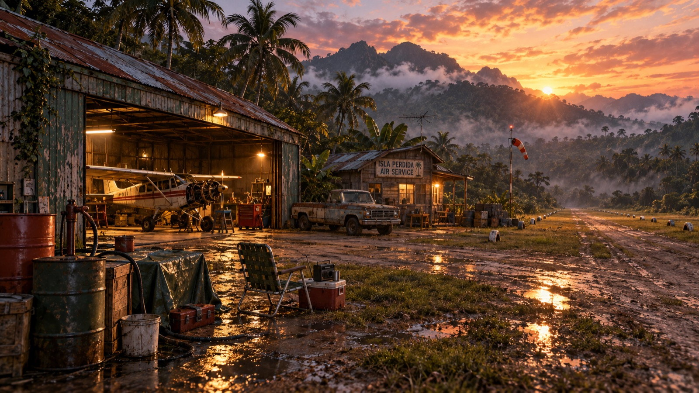
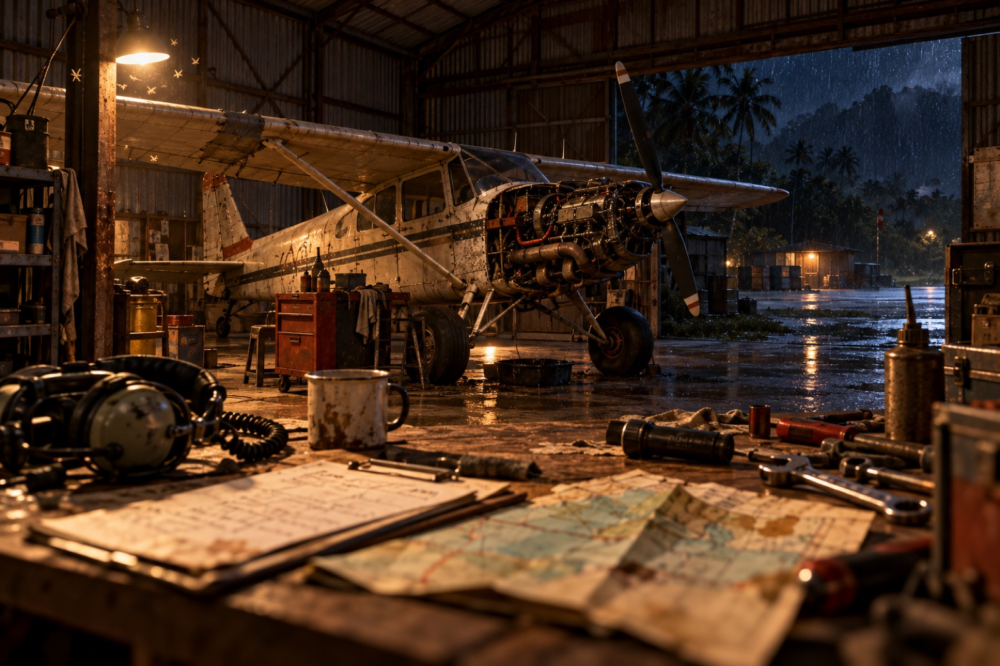
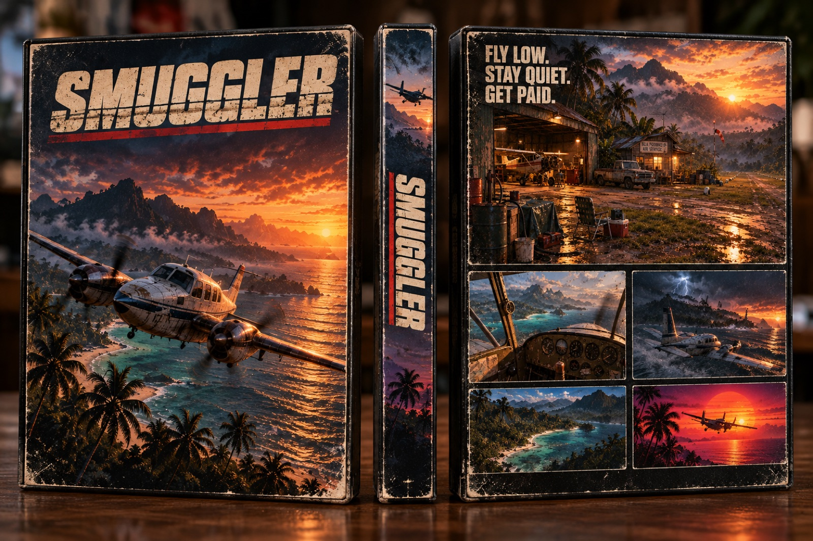

<div align="center">

# S M U G G L E R

### Fly low. Stay quiet. Get paid.

**A flight game about running cargo in tired old airplanes, in a world that never quite existed.**


<br><br>


<sub><i>"Wow, everything looks pretty from up there… oh crap, focus on the instruments, it's windy."</i></sub>

</div>

---

It's 1983. You have a worn-out taildragger, a paper map, a compass, and a buyer waiting on a dirt strip three islands away. The weather is turning. The radio forecast was wrong again. Somewhere out there is a radar station you'd rather stay under.

**Smuggler** is a single-player flight game for people who love to *actually fly*. The physics and the weather come first: the airplanes behave the way real ones do. The world, the jobs and the shady people in it give you a reason to take off.

<table>
<tr>
<td width="50%"></td>
<td width="50%"></td>
</tr>
</table>

---

## ✈️ What makes it different

<table>
<tr>
<td width="55%">

### Real physics, not a script
Built on **[JSBSim](https://github.com/JSBSim-Team/jsbsim)**, the open-source flight model used in research and professional simulators. Stalls, crosswinds, P-factor, ground effect and ground handling all come out of the physics. Every airplane is automatically tested against published real-world performance figures before anyone flies it.

</td>
<td width="45%"></td>
</tr>
<tr>
<td width="45%"></td>
<td width="55%">

### Weather is the enemy, and your cover
Wind that changes with altitude, gusts, turbulence, fog, rain and night strips with no lights. A storm can ground you, or hide you from the radar. The radio forecast is 1980s-accurate: often wrong.

</td>
</tr>
<tr>
<td width="55%">

### You run the engine
Master switch, magnetos, primer, mixture, carb heat, fuel selector. Cold starts, flooded engines, hand-propping the little one. Lean it wrong and you'll *hear* it stumble.

### No HUD. Ever.
Everything you know comes from the gauges in front of you and the map on your knee. No minimap, no waypoint markers, no floating arrows.

</td>
<td width="45%"></td>
</tr>
<tr>
<td width="45%"></td>
<td width="55%">

### A ladder of airplanes
Start with something cheap and tired. Work your way up to bigger, faster, more capable aircraft, and fit them out for the job: long-range tanks, short-field kits, better radios, a fresh registration.

### A world with attitude
1978–1988. Fictional islands and coastlines with realistic terrain: jungle strips, beaches, farms and forgotten airfields. Grounded, with a streak of dark comedy. Closer to an 80s crime show than a flight lesson.

</td>
</tr>
</table>

> All aircraft, places, companies and people in Smuggler are fictional.

---

## 🛠️ Where it stands

**Early development.** The flying has to feel right before we build the game on top of it.

| | |
| --- | --- |
| ✅ **Flying** | Two aircraft on JSBSim: a light tube-and-fabric taildragger and a classic four-seat trainer |
| ✅ **Cockpits** | 3D cockpits with period gauges and clickable switches |
| ✅ **Engines** | Full start-up and engine management, with electrical and vacuum systems |
| ✅ **World** | Hilly 16 × 16 km terrain with a paved valley strip and a dirt hilltop strip. The ground is real to the physics, so slopes, dirt and grass all handle differently. |
| ✅ **First flight** | A guided tutorial flight with checklists that tick themselves as you go |
| ✅ **Controls** | Joystick, throttle and rudder pedals (HOTAS), plus gamepad and keyboard |
| ✅ **Sound** | Engine, propeller, wind and tyre sound generated live from the engine model. A bad mixture or a single magneto sounds rough. |
| ✅ **Wind** | Wind that changes with height, gusts and turbulence, windsocks at every strip and a barometric altimeter. One weather system drives both the physics and the visuals. |
| 🔧 **Next up** | Day and night with compressed time, unlit night strips, fog, rain and clouds |

<sub>The images on this page are concept art showing the look we're aiming for. They're not in-game screenshots yet.</sub>

---

## 🗺️ The plan

Each phase has a gate, and the next phase doesn't start until that gate has been passed *in the air*.

| Phase | What it adds | Gate |
| --- | --- | --- |
| **0 · First flight** ✅ | Flight-model bridge, first airplane, test airfield | Take off, fly a circuit, land |
| **1 · Flight core** ✅ | Cockpits, engine management, sound, real terrain, second airplane | Real stall, climb and take-off numbers; ground handling feels right |
| **2 · Weather** 🔧 | Wind by altitude, gusts, turbulence, fog, rain, day and night | A gusty crosswind landing at dusk feels hard but fair |
| **3 · The loop** | Jobs, cargo, weight and balance, fuel, money, wear and repairs, radar zones, the paper map, an island group to fly | One full session is fun to play *and* fun to watch |
| **4 · The world** | More airplanes and upgrades, pursuit, reputation, contacts, radio chatter, a bigger map | Content-complete for Early Access |
| **5 · Release** | Performance pass, Windows build, playtests | Stable on Mac and Windows |

Target: **Steam Early Access on macOS and Windows.**

<div align="center">

</div>

---

## 🤝 Want to help?

This is a public, open project and help is very welcome. **Fork it, make something better, open a pull request.** That's it.

You don't need to write code to make a real difference:

| | |
| --- | --- |
| 🛩️ **Pilots and sim flyers** | Fly it and tell us where it feels wrong. *"At 55 knots with full flaps the nose drops too fast"* is gold. |
| 🎨 **3D artists** | Period aircraft, cockpits, hangars, vehicles and props in Blender. They need to look real and run fast. |
| 🔊 **Sound people** | Recordings of old piston engines, cockpit ambience, radio. Access to a vintage airplane and a recorder? Let's talk. |
| 🗺️ **World builders** | Islands, coastlines, jungle and farmland that look right from 500 feet. |
| 🎙️ **Voices** | Radio chatter: towers, coast guard, nervous clients. |
| 💻 **Developers** | Godot (GDScript) and C++: flight systems, tools, performance. |
| 🪟 **Windows testers** | Development happens on a Mac, so Windows needs extra eyes. |

**How to contribute**
1. Fork the repo and make your change on a branch.
2. Open a pull request saying what it does and how to try it.
3. Got an idea or found a bug? [Open an issue](https://github.com/NikolasKorakidis/smuggler/issues).

**Three simple rules**
- **Keep it fictional.** No real manufacturer names, logos, companies, places or people.
- **Physics wins.** If a change makes the game prettier but the flying less honest, it won't go in.
- **Only submit your own work**, or work that's clearly licensed for use in a commercial game.

---

## 💻 For developers

**Stack:** Godot 4.7 (GDScript) · JSBSim 1.3 (C++) through a GDExtension · Python and pytest for headless flight-model tests · Blender for assets.
Development currently happens on **macOS, Apple Silicon**.

```bash
git clone --recursive https://github.com/NikolasKorakidis/smuggler.git
cd smuggler
scripts/bootstrap.sh              # checks your tools; add --install to fetch what's missing
scripts/build_extension.sh        # builds JSBSim and the Godot bridge (first build ~3 min)
.venv/bin/pytest tests/fdm        # flight-model tests against real-world figures
godot --path game                 # fly
```

| Folder | What's in it |
| --- | --- |
| `game/` | The Godot project. Each aircraft is pure data in `game/aircraft/<model>/`, with no aircraft-specific code. |
| `extensions/jsbsim_gd/` | The C++ bridge between JSBSim and Godot |
| `tests/fdm/` | Headless physics tests |
| `docs/` | [Design](docs/design.md), [roadmap](docs/roadmap.md), task list and decision log |

---

<table>
<tr>
<td width="40%"></td>
<td width="60%">

## How it's made

Smuggler is designed, directed and test-flown by **Nikolas**. The code is written with **[Claude Code](https://claude.com/claude-code)** as a development partner. Every change has to pass the automated physics tests, and then get flown with a real stick, throttle and pedals, before it's accepted.

## License

A license for the game's code and assets hasn't been chosen yet. JSBSim is used under the LGPL.

<br>



</td>
</tr>
</table>

<div align="center">
<br>
<b>Fly low. Stay quiet. Get paid.</b>
<br><br>
</div>
